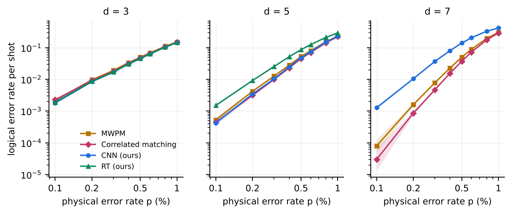
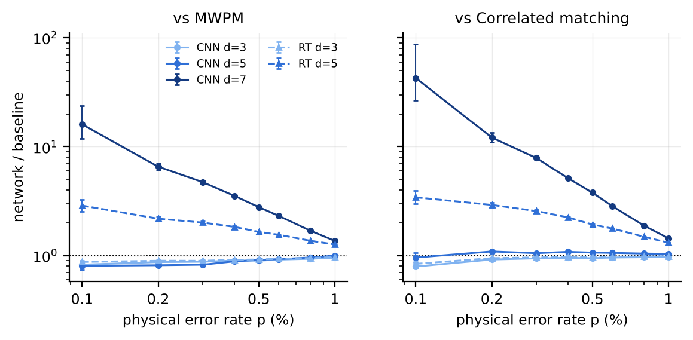

# Syndrome Lab

**An open, small-scale, CPU-only reproduction of neural decoding for the surface code,
compared carefully against minimum-weight perfect matching.**

> **This is not new research.** It reproduces, at small scale and with full
> transparency, a result that is already established (AlphaQubit and others): small
> neural networks can out-decode MWPM on small surface codes, and keeping that
> advantage as the code grows is expensive. Where the network loses here, the numbers
> are published anyway.

- **Play:** inject X, Y and Z errors into a simulated chip and watch MWPM and a neural
  network correct them, step by step, in your browser. → `web/` (GitHub Pages)
- **Results:** logical error rates with confidence intervals, thresholds, latency and
  out-of-distribution noise. → `web/results.html`, `results/summary.json`
- **Report:** 8-page technical report. → `report/syndrome-lab-report.pdf`
- **Explained from scratch (Spanish):** `docs/DEFENSA.md`

<!-- RESULTS:START -->
## Result, unvarnished

Logical errors of the network divided by those of the baseline, on identical test shots
(SI1000 circuit noise, 200,000 shots per point, seeds pooled; range over p = 0.1% … 1%).
Below 1 the network wins.

| Distance | Network | vs MWPM | vs correlated matching | Verdict |
|---|---|---|---|---|
| 3 | CNN | 0.82 – 0.96 | 0.79 – 0.98 | wins against both |
| 3 | RT | 0.87 – 0.97 | 0.84 – 0.99 | wins against both |
| 5 | CNN | 0.81 – 0.96 (tie at 1%) | 1.04 – 1.09 (tie at 0.1%) | beats MWPM, **loses to correlated matching** |
| 5 | RT | 1.3 – 2.9 | 1.3 – 3.4 | **loses** (under-trained) |
| 7 | CNN | 1.4 – 16 | 1.4 – 43 | **loses badly** |
| 7 | RT | not trained | | did not fit the CPU budget |

- **Latency:** the networks are 60–320× slower per shot than PyMatching on one CPU core.
- **Unseen noise:** at d = 3 the networks still win; at d = 5 the lead shrinks. The recurrent
  model does **not** generalize to more rounds than it was trained on.
- **Finite-size crossings (SI1000):** MWPM 0.47% and 0.53%; correlated matching 0.53% and 0.59%;
  CNN 0.47% (d = 3–5) and no crossing for d = 5–7.
- **Cost:** 13 models, 12.4 CPU-hours in total.




<!-- RESULTS:END -->

## What is compared

| | |
|---|---|
| Code | rotated surface code, distances 3, 5, 7, Z-basis memory, d rounds |
| Noise | SI1000 circuit-level noise (Gidney et al. 2021), p from 0.1% to 1% |
| Baselines | MWPM and correlated matching (PyMatching 2.4), given the exact error model |
| Networks | a 3D CNN and a recurrent transformer (AlphaQubit's idea, ~1000× smaller) |
| Protocol | same test shots for every decoder, 3 training seeds, Wilson intervals, paired bootstrap, McNemar |
| Hardware | 4 CPU cores, no GPU, a couple of CPU-hours per model at most |

## Reproduce

```bash
git clone https://github.com/didimacveg/qec-lab && cd qec-lab
python3 -m venv .venv && source .venv/bin/activate
pip install torch --index-url https://download.pytorch.org/whl/cpu
pip install -r requirements.txt
make test                 # unit tests + validation against published thresholds
make all SCALE=0.01       # full pipeline smoke run, minutes
make all                  # the real thing, hours on 4 cores
```

Seeds and configurations: `configs/experiment.json`. Trained weights: `models/`.
Raw results: `results/`. Decisions and their reasons: `docs/DECISIONS.md`.

## Validation of the setup

- MWPM corrects every single fault of the circuit-level error model (d = 3, 5).
- Code-capacity MWPM crossings at 9.6–9.8% for d = 5…13 (published asymptotic
  threshold 10.3%; small rotated codes are known to cross slightly lower).
- Circuit-level crossings in the published range (about 0.5% for SI1000).
- Our Monte Carlo loop agrees with `sinter`.
- The browser decoders match PyMatching (matching weight) and PyTorch (logits).

## Limitations

Small distances only. Simulated noise only (no leakage, crosstalk or drift). Z-basis
memory only. SI1000 rates applied to Stim's CX circuit, not a CZ compilation.
Networks output one bit per shot and are not streaming decoders. Latency measured in
plain PyTorch on a CPU. Crossings from d = 3–7 are finite-size estimates, not
asymptotic thresholds. See `web/method.html`.

## Prior work

AlphaQubit: Bausch et al., *Nature* (2024), doi:10.1038/s41586-024-08148-8.
AlphaQubit 2: Senior et al., arXiv:2512.07737. Mamba decoders: Lee, Hur and Park,
arXiv:2510.22724. QuTech: Varbanov et al., *Phys. Rev. Research* 7, 013029 (2025).
Stim: Gidney, *Quantum* 5, 497 (2021). PyMatching: Higgott and Gidney,
arXiv:2303.15933. SI1000: Gidney et al., *Quantum* 5, 605 (2021). Full list with
verification status: `docs/RESEARCH.md`.

## Credits

Built by Diego Macías Vega (17, Madrid) with substantial help from AI coding tools.
Apache-2.0. The repository is called `qec-lab` for now; the proposed name is
Syndrome Lab (`docs/RESEARCH.md` §4).
